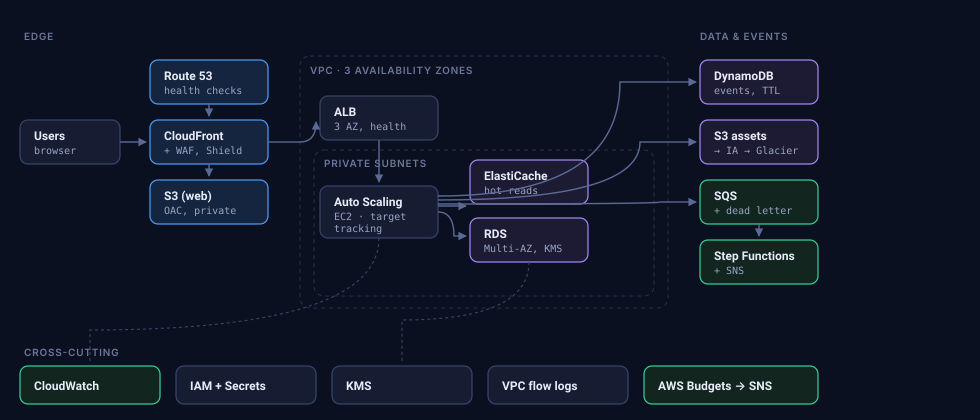

# Cloud Time Machine

**Travel through the evolution of cloud architecture — then design the future yourself.**

An interactive platform where you pick a company and a year, see the architecture
a team would plausibly have been running then, push traffic through it, break its
database, point a DDoS at it, watch its storage bill grow, and compare all of it
with a modern AWS design. Then you build your own architecture by dragging
services onto a canvas and get it scored by the same engines.



## What is in here

| Path | What it is |
| --- | --- |
| `backend/` | Node.js + Express API. Holds the service catalog, the era architectures, and every simulation engine. |
| `frontend/` | React + React Flow single-page app. Explore mode and the drag-and-drop builder. |
| `infrastructure/cloudformation/` | Five CloudFormation stacks that deploy the whole thing to AWS. |
| `infrastructure/scripts/` | `build.sh`, `deploy.sh`, `smoke.sh`, `destroy.sh`. |
| `docs/` | Architecture notes, AWS setup walkthrough, cost breakdown, API reference. |

## Run it locally (no AWS account needed)

Every AWS integration falls back to an in-process implementation when its
environment variable is absent, so the full application runs on a laptop.

```bash
npm run install:all    # installs the root, backend and frontend
npm run dev            # API on :8080, front end on :5173
```

Open <http://localhost:5173>.

```bash
npm test               # 45 tests over the engines and the HTTP API
```

`install:all` installs three separate `package.json` files, including the one at
the root, which is where `concurrently` lives. Running `npm install` only in
`backend/` and `frontend/` leaves `npm run dev` with no way to start both at
once.

### On Windows

`npm run install:all`, `npm run dev` and `npm test` work in PowerShell and
Command Prompt as they are.

The deployment scripts are bash, so `npm run build`, `deploy`, `smoke` and
`destroy` need **Git Bash** or **WSL**. Git Bash ships with Git for Windows;
open it in the repository folder and run them there.

## Deploy it to AWS

```bash
export AWS_PROFILE=your-profile
export ALERT_EMAIL=you@example.com
npm run deploy
```

That script does everything: looks up the CloudFront prefix list, generates and
stores the origin secret, deploys the five stacks in dependency order, builds and
uploads the API bundle and the front end, and invalidates the CDN. It takes
about 20 minutes the first time, mostly waiting for RDS and CloudFront. It is
safe to re-run; CloudFormation applies only the differences.

```bash
npm run smoke          # verifies the deployed site end to end
npm run destroy        # tears it down (keeps data-bearing resources)
```

### What you have to do yourself

Four things, and nothing else:

1. **An AWS account with the AWS CLI configured.** `aws configure`, or
   `export AWS_PROFILE=...`. The deploy script refuses to run without working
   credentials. The IAM principal needs to create VPCs, EC2, RDS, DynamoDB, S3,
   CloudFront, WAF, IAM roles, SNS, SQS, Step Functions, CloudWatch and Budgets —
   in practice an administrator in a sandbox account.
2. **Confirm the SNS subscription email.** AWS sends a confirmation link to
   `ALERT_EMAIL`; alerts do not arrive until you click it.
3. **Enable Budgets on a brand-new account**, if prompted. Cost Explorer has to
   be switched on once per account before `AWS::Budgets::Budget` works, and it
   can take up to 24 hours to become available. If `40-ops` fails on the budget
   resource, that is why — deploy the rest and re-run that stack later.
4. **A domain, only if you want one.** Without it the site is served on its
   `*.cloudfront.net` name over HTTPS, which works fine. With one, request an
   ACM certificate **in us-east-1**, then set `DOMAIN_NAME` and
   `CERTIFICATE_ARN` and point a Route 53 alias at the distribution.

Everything else — networking, encryption, scaling policies, alarms, the
dashboard, lifecycle rules, the deployment artefacts — is in the templates.

### Cost

The defaults are a real three-AZ deployment, which costs
**roughly $116/month** — about $34 of that is the single NAT gateway and $17 the
load balancer. On a 12-month free-tier account it is closer to **$66/month**.
`DB_MULTI_AZ=true` adds about $15, and one NAT gateway per AZ adds $66. See
[docs/COST.md](docs/COST.md) for the line-by-line breakdown and how to spend
less.

Remember that an idle deployment still costs money. Run `npm run destroy` when
you are finished with it.

### Deployment knobs

All optional, all environment variables read by `deploy.sh`:

| Variable | Default | Notes |
| --- | --- | --- |
| `ENVIRONMENT` | `prod` | `dev`, `staging` or `prod`. Picks backup retention, deletion protection and point-in-time recovery. |
| `AWS_REGION` | `us-east-1` | CloudFront-scoped WAF only exists in us-east-1, so the stack stays there. |
| `ALERT_EMAIL` | *(none)* | Subscribed to the alert topic and the budget. |
| `MONTHLY_BUDGET_USD` | `50` | Alerts at 80% actual and 100% forecast. |
| `INSTANCE_TYPE` | `t3.small` | `t3.micro` is free-tier eligible. |
| `MIN_SIZE` / `MAX_SIZE` | `2` / `6` | Auto Scaling bounds. |
| `DB_INSTANCE_CLASS` | `db.t3.micro` | Free-tier eligible. |
| `DB_MULTI_AZ` | `false` | `true` for a synchronous standby in a second AZ. |
| `SINGLE_NAT` | `true` | `false` deploys one NAT gateway per AZ (+$66/month). |
| `DOMAIN_NAME`, `CERTIFICATE_ARN` | *(none)* | Both or neither. |

## How the simulations work

Everything runs on one data structure: an architecture graph of
`{ id, type, props }` nodes and `{ from, to }` edges. A stock era architecture
and something you dragged together are the same shape, so they go through
identical engines and are scored by identical rules.

The service catalog (`backend/src/data/catalog.js`) is the single source of
truth. Each of the 32 service types declares its role in the request path, its
capacity in requests per second, the security controls it provides, how many
Availability Zones it survives losing, and a cost function. Change a number
there and every simulator, score and estimate changes with it.

- **Traffic** walks the request path tier by tier, reduces load by whatever each
  tier absorbs (a CDN cache hit never reaches the origin), and finds the first
  tier that saturates. Latency grows non-linearly as a tier fills, which is why
  a 90%-utilised tier is already slow. A queue converts overflow into waiting
  rather than errors.
- **Failure** kills a component and reports what users see: how long writes
  fail, how much data is lost, and whether a human has to intervene. Multi-AZ
  RDS turns a four-hour restore into a 90-second failover, and the simulator
  shows exactly that.
- **DDoS** filters the attack through each defence in turn — Shield Standard,
  CloudFront cache hits, WAF rate rules — then puts what is left in competition
  with real users for origin capacity, and prices the bandwidth.
- **Storage** projects volume forward at a growth rate and compares three
  lifecycle policies, because the gap between them is the entire argument for
  tiering.
- **Cost** sums per-node estimates from published us-east-1 list prices, then
  produces ranked optimisations with the saving each one makes at this workload.
- **Security** and **availability** score against weighted control lists and
  series/parallel uptime, and both report *which* points are missing rather than
  only a number.

The numbers are illustrative, not a quote. Pricing is us-east-1 list price as of
August 2025, response size is assumed at 180 KB, and the company growth curves
are plausible shapes rather than published metrics. The point is the shape of the
trade-offs, which is robust; the third significant figure is not.

## AWS services used

**24 services, 82 resources** across the five stacks:

**EC2** · **Auto Scaling** · **Application Load Balancer** · **S3**
(+ **Glacier** lifecycle tiers) · **EBS** · **CloudFront** · **RDS** (Multi-AZ
optional) · **DynamoDB** · **IAM** · **VPC** · **Security Groups** · **VPC
Endpoints** · **VPC Flow Logs** · **SNS** · **SQS** · **Step Functions** ·
**CloudWatch** · **KMS** · **AWS Budgets** · **WAF** · **Shield Standard** ·
**Secrets Manager** · **Systems Manager** · **CloudWatch Logs**.

```bash
npm run services       # prints the list, counted from the templates themselves
```

That command parses `infrastructure/cloudformation/*.yaml` rather than reading a
hand-kept list, so the count cannot drift away from what is actually deployed.

Modelled in the simulator as well, and draggable in the builder, but not part of
the deployed stack: ElastiCache, Aurora, Lambda, ECS on Fargate, Route 53,
Shield Advanced.

## Documentation

- [docs/ARCHITECTURE.md](docs/ARCHITECTURE.md) — how the pieces fit, and why
- [docs/AWS_SETUP.md](docs/AWS_SETUP.md) — deployment walkthrough and troubleshooting
- [docs/API.md](docs/API.md) — every endpoint with an example
- [docs/COST.md](docs/COST.md) — what it costs and how to spend less
